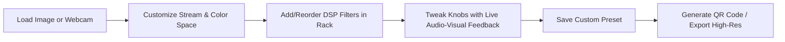
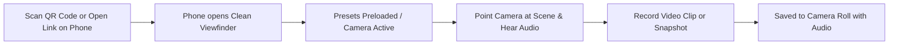

# Sonification V2 — Product Requirements Document (PRD)

---

## 1. Product Overview
**Sonification V2** is a real-time web application and creative mobile sound camera that translates digital imagery into audio waveforms, applies audio digital signal processing (DSP), and reconstructs the output into glitched visuals accompanied by synthesized audio.

---

## 2. Target Users & Personas

1. **Glitch & Visual Artists:**
   - Needs: Unique databending aesthetics, precise control over color spaces and bit serialization, high-res export (4K+).
   - Frustrations with old tools: Slow rendering, command-line/hex-editor/Audacity import-export friction, inability to preview changes in real time.
2. **Audio-Visual Performers & Sound Designers:**
   - Needs: Live camera feed reacting to stage lighting, real-time audio output through PA systems, fast preset switching.
3. **Mobile Creators & Photographers:**
   - Needs: Fast, touch-friendly "sound camera" interface on phone; quick camera flip (front/back); instant video recording with audio for social media; easy preset loading via QR code.

---

## 3. Core Workflows & User Journeys

### Workflow A: Desktop Studio Sound-Design

1. User opens the application on desktop.
2. Selects input source: Image drag-and-drop or Webcam.
3. Configures stream parameters (Color space: LAB, Mode: Planar, Encoding: A-Law, Bits: 16-bit).
4. Adds filters from the library (`DjEq`, `Vcf303`, `CanyonDelay`, `Vynil`, `Comb`).
5. Live canvas shows instant glitched feedback; Web Audio plays the corresponding sound through speakers.
6. User clicks **"Save Preset"**, names it "Cyberpunk Acid Decay".
7. Clicks **"Mobile QR Code"** to sync with their phone.

---

### Workflow B: Mobile "Sound Camera"

1. User scans the QR code with their mobile device camera or opens the shared URL.
2. The web app detects a mobile viewport and opens the **Mobile Sound Camera View**:
   - Fullscreen viewfinder with live rear camera.
   - Minimalist bottom control bar: Shutter button (tap for photo, hold for video), Camera Flip button, Sound Mute/Unmute, Preset Picker carousel.
3. User points the phone around the room: high-contrast lines and movements create auditory sweeps and visual databend artifacts.
4. User taps **Record Video**: captures glitched video and sound together. Video downloads directly to camera roll.

---

## 4. Functional Requirements

### 4.1 Input Sources (F1)
- **F1.1 Image Import:** Drag-and-drop or file selector for JPG, PNG, WebP, SVG, TIFF.
- **F1.2 Camera Feed:** Live webcam (desktop) or front/rear camera (mobile) using `navigator.mediaDevices.getUserMedia`.
- **F1.3 Camera Controls:** Front/back camera toggle, resolution selector ($360\text{p}$, $480\text{p}$, $720\text{p}$, $1080\text{p}$).
- **F1.4 Video File Input:** Loop an imported MP4/WebM video file through the databend engine.

---

### 4.2 Stream Encoding & Serialization (F2)
- **F2.1 Color Space Conversions (Input & Output):**
  - RGB (Standard)
  - LAB (CIE $L^*a^*b^*$ perceptual color space)
  - LUV (CIE $L^*u^*v^*$)
  - HCL (Hue-Chroma-Luminance)
  - XYZ (CIE 1931 standard observer)
  - Yxy (Chromaticity coordinate system)
  - CMY (Subtractive cyan-magenta-yellow)
  - OHTA ($I_1, I_2, I_3$ color space)
- **F2.2 Stream Topology:**
  - `PLANAR`: Channels contiguous ($R_1\dots R_N$, $G_1\dots G_N$, $B_1\dots B_N$).
  - `INTERLEAVED`: Pixels contiguous ($R_1 G_1 B_1 R_2 G_2 B_2\dots$).
- **F2.3 Quantization & Packing:**
  - Bit depth: 8-bit, 16-bit, 24-bit per sample.
  - Endianness: Little Endian, Big Endian.
  - Sign: Signed, Unsigned.
- **F2.4 Companding Laws:**
  - Linear (`NONE`)
  - **A-Law** (European ITU-T standard logarithmic companding)
  - **$\mu$-Law** (North American / Japanese ITU-T standard)

---

### 4.3 Modular DSP Filter Rack (F3)
- **F3.1 Filter Library (22 DSP Units):**
  1. `DjEq`: 3-band biquad equalizer (low shelf, peak, high shelf).
  2. `Comb`: Feedback comb filter with cubic interpolation.
  3. `Vynil`: Turntable simulation (motor warp, surface wear, click/pop triggers).
  4. `CanyonDelay`: Stereo cross-feedback delay with lowpass damping.
  5. `Vcf303`: Roland TB-303 voltage-controlled resonant acid filter with decay envelope.
  6. `AuEcho`: Classic feedback echo with variable decay.
  7. `AuPhaser`: Multi-stage all-pass phaser with exponential LFO.
  8. `AuWahwah`: Resonant bandpass swept by sinusoidal LFO.
  9. `AuBassTreble`: Audacity shelving tone controls.
  10. `TShiftR`: Non-linear feedback root fold distortion.
  11. `TapSigmoid`: Soft saturation / overdrive curve.
  12. `TapAutopan`: Stereo panning LFO modulation.
  13. `Randmix`: FIR filter with randomized impulse weighting history.
  14. `Divider`: Subharmonic zero-crossing pitch divider.
  15. `LFOPhaser`: 6-stage all-pass phaser with modulated LFO.
  16. `FourByFourPole`: 16-stage all-pass filter bank (4 poles $\times$ 4 stages).
  17. `AutoPhaser`: Envelope-follower controlled dynamic phaser.
  18. `AuAmplify`: Linear gain multiplier / attenuator.
  19. `TReverb`: Long delay / comb reverb with feedback.
  20. `VacuumTubeAmp`: Non-linear vacuum tube transfer function.
  21. `ResonFilter`: 2-pole resonating bandpass filter.
  22. `PluckedString`: Karplus-Strong physical string model.
- **F3.2 Rack Controls:**
  - Drag-and-drop reordering of filters in the chain.
  - Bypass / Enable toggle per filter.
  - Real-time parameter knobs with number displays.
  - Sample rate selector per filter ($22050\text{ Hz}$, $44100\text{ Hz}$, $88200\text{ Hz}$, etc.).
- **F3.3 Randomizer Modes:**
  - **Randomize Parameters (`c`):** Randomizes values of active filters.
  - **Randomize Filters (`f`):** Generates 1–4 random filters in the chain.
  - **Randomize Stream (`r`):** Randomizes color spaces, bit depth, topology, and companding laws.

---

### 4.4 Post-Processing & Blending (F4)
- **F4.1 Histogram Equalization:** Independent 3-channel cumulative histogram equalization and normalization to restore dynamic range.
- **F4.2 Blend Modes:** Blend processed image with the original input (`OVERLAY`, `SCREEN`, `MULTIPLY`, `DIFFERENCE`, `ADD`, `EXCLUSION`) with an opacity slider.

---

### 4.5 The "Sound Camera" & Audio Synthesis (F5)
- **F5.1 Web Audio Player:** Stream the processed 1D float sample buffer directly to an `AudioBufferSourceNode` or `AudioWorkletNode`.
- **F5.2 Audio Controls:** Master volume slider, Mute toggle, Looping toggle.
- **F5.3 Audio Visualizer:** Mini real-time oscilloscope or spectrogram showing the audio waveform generated by the image.

---

### 4.6 Preset Management & Cross-Device Handoff (F6)
- **F6.1 Curated Factory Presets:** 8+ bundled presets showcasing distinct visual aesthetics.
- **F6.2 User Presets:** Save custom presets to browser `localStorage` or export to JSON.
- **F6.3 Instant QR Code Generator:** Modal displaying a QR code encoding the active preset into the URL hash (`#p=<base64-compressed-json>`).
- **F6.4 URL Share Link:** Copy link to clipboard for instant 1-click sharing.

---

### 4.7 Recording & Export (F7)
- **F7.1 High-Resolution Photo Snapshot:** Renders the current frame at native resolution and downloads as PNG or JPEG.
- **F7.2 Glitch Video Recording:** Uses `MediaRecorder` API to capture canvas frames and audio stream simultaneously, exporting `.webm` or `.mp4` video.

---

## 5. Non-Functional Requirements

1. **Performance & Frame Rate:**
   - Camera preview: Stable $\ge 30\text{ FPS}$ on typical modern smartphones (iOS A14+ / Android Snapdragon 700+).
   - Desktop preview: Stable $60\text{ FPS}$ at $640 \times 360$ and $1280 \times 720$.
   - High-Res Export: $<100\text{ ms}$ for 4K single image render.
2. **Memory & Zero-Allocation:**
   - No object allocation (`new Object`, `new Float`) inside inner sample processing loops.
   - Ring buffers for delays/reverbs pre-allocated once per session using typed arrays (`Float32Array`).
3. **Cross-Browser Compatibility:**
   - 100% compatible with Chrome, Safari (iOS/macOS), Firefox, and Edge.
   - Graceful fallback if camera permissions are denied.
4. **Privacy:**
   - 100% client-side execution. No user photos, video feeds, or audio ever leave the device.
