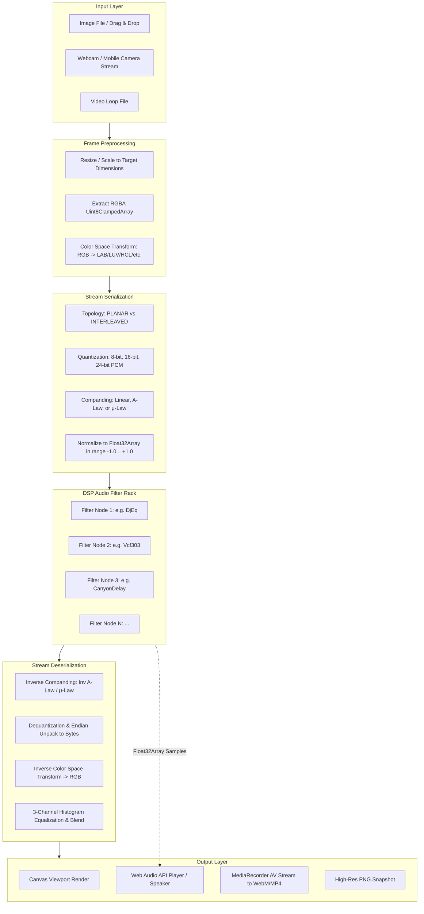
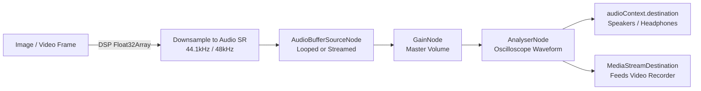
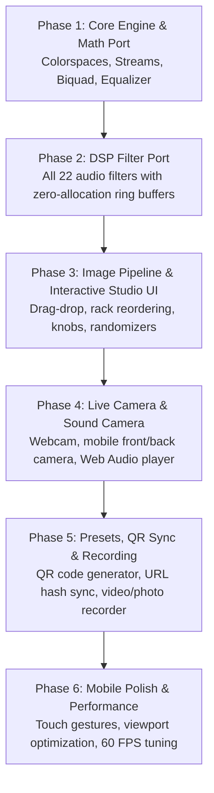

# Sonification V2 — Technical & Architectural Specifications (SPECS)

---

## 1. System Architecture Overview



---

## 2. Core Mathematical Specifications

### 2.1 Companding Laws (Telephony Audio Codecs)

#### 1. A-Law Compression & Expansion (ITU-T G.711)
Constants: $A = 87.6$, $\ln(A) \approx 4.47278$, $1 + \ln(A) \approx 5.47278$.

$$\text{Encode: } f(x) = \operatorname{sgn}(x) \cdot \begin{cases}
\dfrac{A |x|}{1 + \ln(A)}, & \text{if } |x| < \dfrac{1}{A} \\[8pt]
\dfrac{1 + \ln(A |x|)}{1 + \ln(A)}, & \text{if } \dfrac{1}{A} \le |x| \le 1
\end{cases}$$

$$\text{Decode: } f^{-1}(y) = \operatorname{sgn}(y) \cdot \begin{cases}
\dfrac{|y| (1 + \ln(A))}{A}, & \text{if } |y| < \dfrac{1}{1 + \ln(A)} \\[8pt]
\dfrac{\exp\big(|y|(1 + \ln(A)) - 1\big)}{A}, & \text{otherwise}
\end{cases}$$

#### 2. $\mu$-Law Compression & Expansion (ITU-T G.711)
Constants: $\mu = 255.0$, $\ln(1 + \mu) \approx 5.545177$.

$$\text{Encode: } f(x) = \operatorname{sgn}(x) \cdot \frac{\ln(1 + \mu |x|)}{\ln(1 + \mu)}$$

$$\text{Decode: } f^{-1}(y) = \operatorname{sgn}(y) \cdot \frac{(1 + \mu)^{|y|} - 1}{\mu}$$

---

### 2.2 Color Space Transformations

All color spaces operate on normalized RGB components: $r, g, b \in [0, 1]$.

#### 1. CIE XYZ & sRGB Companding
Linearization (sRGB $\to$ linear RGB):
$$\gamma(c) = \begin{cases}
\dfrac{c}{12.92}, & \text{if } c \le 0.04045 \\[6pt]
\left(\dfrac{c + 0.055}{1.055}\right)^{2.4}, & \text{if } c > 0.04045
\end{cases}$$

$$\begin{bmatrix} X \\ Y \\ Z \end{bmatrix} = \begin{bmatrix} 
0.4124 & 0.3576 & 0.1805 \\
0.2126 & 0.7152 & 0.0722 \\
0.0193 & 0.1192 & 0.9505
\end{bmatrix} \begin{bmatrix} \gamma(r) \\ \gamma(g) \\ \gamma(b) \end{bmatrix} \times 100$$

#### 2. CIE $L^*a^*b^*$ (D65 Illuminant)
Constants: $X_n = 95.0456$, $Y_n = 100.0$, $Z_n = 108.8754$, $\epsilon = 216/24389 \approx 0.008856$, $\kappa = 24389/27 \approx 903.3$.

$$f(t) = \begin{cases}
t^{1/3}, & \text{if } t > \epsilon \\
\dfrac{\kappa t + 16}{116}, & \text{if } t \le \epsilon
\end{cases}$$

$$L^* = 116 f(Y / Y_n) - 16, \quad a^* = 500 \left[ f(X / X_n) - f(Y / Y_n) \right], \quad b^* = 200 \left[ f(Y / Y_n) - f(Z / Z_n) \right]$$

#### 3. CIE $L^*u^*v^*$
$$u' = \frac{4X}{X + 15Y + 3Z}, \quad v' = \frac{9Y}{X + 15Y + 3Z}$$
$$L^* = \begin{cases} 116(Y / Y_n)^{1/3} - 16, & \text{if } Y/Y_n > \epsilon \\ \kappa (Y / Y_n), & \text{otherwise} \end{cases}$$
$$u^* = 13 L^* (u' - u'_n), \quad v^* = 13 L^* (v' - v'_n)$$

#### 4. HCL (Hue-Chroma-Luminance)
Derived from polar transformations of chromaticity with perceptual weights:
$$\text{Luminance } L = 0.298839 r + 0.586811 g + 0.114350 b$$
$$\text{Chroma } C = \max(r, g, b) - \min(r, g, b)$$
$$\text{Hue } H = \text{standard hexcone angle } [0, 6)$$

#### 5. OHTA Color Space
Decorrelated color features developed by Y. Ohta for optimal segmentation:
$$I_1 = \frac{R + G + B}{3}, \quad I_2 = \frac{R - B}{2}, \quad I_3 = \frac{2G - R - B}{4}$$

---

### 2.3 Audio DSP Algorithms (Port Specifications)

#### 1. Direct-Form II Transposed Biquad Filter
Transfer function:
$$H(z) = \frac{b_0 + b_1 z^{-1} + b_2 z^{-2}}{1 + a_1 z^{-1} + a_2 z^{-2}}$$
Difference equation (Direct Form II):
$$y[n] = b_0 x[n] + b_1 x[n-1] + b_2 x[n-2] - a_1 y[n-1] - a_2 y[n-2]$$
Used by: `DjEq` (3-band low-shelf, peaking, high-shelf), `AuBassTreble`, `Vynil` (noise bandpass, high-pass rumble, motor low-pass).

#### 2. Comb Filter with Cubic Hermite Interpolation
Delay line buffer size: $N = 16384$ ($2^{14}$). Fractional delay: $d = f_s / f$.
$$y[n] = \frac{1}{2} \Big( x[n] + \text{Hermite}\big(\text{buffer}[n - d], \dots\big) \Big)$$
$$\text{buffer}[n] = x[n] + \text{feedback} \cdot \text{interpolated}$$

#### 3. Roland TB-303 Voltage-Controlled Filter (`Vcf303`)
Non-linear diode-ladder approximation with resonant exponential cutoff and 64-sample envelope decimation:
$$e_0 = \exp\big(5.613 - 0.8 \cdot \text{env\_mod} + 2.1553 \cdot \text{cutoff} - 0.7696(1 - \text{res})\big) \cdot \frac{\pi}{f_s}$$
$$k = \exp(-(\text{cutoff} + \text{env}) / \text{res})$$
$$a = 2 \cos(2(\text{cutoff} + \text{env})) k, \quad b = -k^2, \quad c = (1 - a - b) \cdot 0.2$$
$$y[n] = a \cdot y[n-1] + b \cdot y[n-2] + c \cdot x[n]$$

#### 4. Canyon Delay (`CanyonDelay`)
Stereo cross-coupled feedback delay with internal one-pole low-pass damping:
$$L_{\text{out}}[n] = x_L[n] \cdot (1 - |g_R|) + R_{\text{buf}}[n - D_R] \cdot g_R$$
$$R_{\text{out}}[n] = x_R[n] \cdot (1 - |g_L|) + L_{\text{buf}}[n - D_L] \cdot g_L$$
$$L_{\text{filt}}[n] = L_{\text{filt}}[n-1] \cdot \alpha + L_{\text{out}}[n] \cdot (1 - \alpha)$$

#### 5. Karplus-Strong String Synthesis (`PluckedString`)
Short delay line $N = \lfloor f_s / f - 0.5 \rfloor$ with all-pass fractional phase compensation filter and loss factor $S$:
$$w[n] = (1 - S) x[n] + S \cdot y[n - N]$$
$$v[n] = a w[n] + w[n-1] - a v[n-1]$$
$$y[n] = \frac{v[n] + v[n-1]}{2}$$

#### 6. Vinyl Record Simulator (`Vynil`)
- Turntable speed flutter and eccentric warp modulation: $\theta_{\text{warp}}(t) = \sin(\omega t) + 0.31 \sin(2\omega t) + 0.129 \sin(3\omega t)$.
- Clicks & dust: Probability generator triggers impulse response buffer with randomized amplitude.
- Asymmetric saturation: $y = \sin(y \cdot g_{\text{wrap}} + \text{bias})$.

---

## 3. High-Performance Memory Architecture

### 3.1 Zero-Allocation Memory Pool
To ensure continuous 60 FPS without garbage collection stutter, memory is pre-allocated during initialization:

```typescript
export class MemoryPool {
  // Preallocated image pixel buffers (up to 4K resolution)
  readonly pixelBufferA: Uint8ClampedArray;
  readonly pixelBufferB: Uint8ClampedArray;

  // Normalized 1D Audio PCM float buffers
  readonly audioSampleBuffer: Float32Array;
  readonly audioOutputBuffer: Float32Array;

  // Preallocated DSP delay line pools
  readonly ringBuffers: Map<string, Float32Array>;

  constructor(maxPixels: number = 3840 * 2160) {
    this.pixelBufferA = new Uint8ClampedArray(maxPixels * 4);
    this.pixelBufferB = new Uint8ClampedArray(maxPixels * 4);
    this.audioSampleBuffer = new Float32Array(maxPixels * 3);
    this.audioOutputBuffer = new Float32Array(maxPixels * 3);
    this.ringBuffers = new Map();
  }
}
```

### 3.2 Power-of-Two Ring Buffers
All circular delay lines are sized to powers of two ($2^K$) so modulo arithmetic is replaced by bitwise AND:
$$\text{index} = (\text{index} + 1) \& (\text{BUFFER\_SIZE} - 1)$$
This eliminates branch prediction failures and integer division in tight loops.

---

## 4. Web Worker & Live Video Pipeline

### 4.1 Frame Processing Strategies
1. **Live Camera Feed (High Frame Rate, Low Latency):**
   - Resolution: $640 \times 360$ ($230,400$ pixels $\approx 691,200$ audio samples) or $1280 \times 720$.
   - Executed **synchronously on main thread** using typed arrays, finishing in **$2\text{ ms} - 5\text{ ms}$**.
   - Direct canvas blit via `ctx.putImageData()` or WebGL 2D texture update.
2. **High-Resolution Photo Render (Up to 4K):**
   - Executed inside a **Web Worker** using `transferable` `ArrayBuffer` objects (zero-copy transfer).
   - Keeps the UI thread responsive during multi-megapixel renders.

---

## 5. Web Audio API Integration (The "Sound Camera")



- When the camera is active, consecutive frames stream audio buffers into a scheduled circular Web Audio buffer or `AudioWorkletNode`.
- Changes in camera orientation or scene lighting immediately modulate the pitch, timbre, and harmonics of the sound.
- The `MediaStreamAudioDestinationNode` feeds directly into `MediaRecorder`, synchronizing the visual glitch with the synthesized glitch sound into a single output video file.

---

## 6. Preset Data Schema & QR Code Compression

Presets are serialized into JSON and compressed with URL-safe Base64 for instant QR code sharing.

### Preset JSON Schema
```json
{
  "$schema": "http://json-schema.org/draft-07/schema#",
  "title": "SonificationPreset",
  "type": "object",
  "required": ["version", "name", "reader", "writer", "filters"],
  "properties": {
    "version": { "type": "integer", "default": 2 },
    "name": { "type": "string" },
    "reader": {
      "type": "object",
      "properties": {
        "rawType": { "enum": ["PLANAR", "INTERLEAVED"] },
        "law": { "enum": ["NONE", "A_LAW", "U_LAW"] },
        "sign": { "enum": ["SIGNED", "UNSIGNED"] },
        "bits": { "enum": [8, 16, 24] },
        "endian": { "enum": ["LITTLE_ENDIAN", "BIG_ENDIAN"] },
        "colorSpace": { "enum": ["RGB", "LAB", "LUV", "HCL", "XYZ", "YXY", "CMY", "OHTA"] }
      }
    },
    "writer": {
      "type": "object",
      "properties": {
        "rawType": { "enum": ["PLANAR", "INTERLEAVED"] },
        "law": { "enum": ["NONE", "A_LAW", "U_LAW"] },
        "sign": { "enum": ["SIGNED", "UNSIGNED"] },
        "bits": { "enum": [8, 16, 24] },
        "endian": { "enum": ["LITTLE_ENDIAN", "BIG_ENDIAN"] },
        "colorSpace": { "enum": ["RGB", "LAB", "LUV", "HCL", "XYZ", "YXY", "CMY", "OHTA"] }
      }
    },
    "equalize": { "type": "boolean" },
    "blendMode": { "enum": ["NONE", "OVERLAY", "SCREEN", "MULTIPLY", "DIFFERENCE", "ADD"] },
    "blendAmount": { "type": "number", "minimum": 0, "maximum": 1 },
    "filters": {
      "type": "array",
      "items": {
        "type": "object",
        "required": ["type", "enabled", "srate", "params"],
        "properties": {
          "type": { "type": "string" },
          "enabled": { "type": "boolean" },
          "srate": { "type": "number" },
          "params": { "type": "object" }
        }
      }
    }
  }
}
```

---

## 7. Phased Implementation Roadmap



### Phase Breakdown
- **Phase 1: Core Mathematical Engine**
  - Implement and verify all 8 color space conversions.
  - Implement raw stream serialization (Planar/Interleaved, 8/16/24-bit, A-law/$\mu$-law, signed/unsigned, big/little endian).
  - Implement 3-channel histogram equalization.
- **Phase 2: Full DSP Audio Filter Suite**
  - Port all 22 filters from the Processing sketch with typed arrays and zero heap allocations.
  - Unit test each filter against known waveforms.
- **Phase 3: Desktop Studio Interface & Static Image Pipeline**
  - Build interactive modular rack UI (reorder, toggle, parameter sliders).
  - Image drop zone, high-res export, A/B comparison slider.
  - Implement randomizers (`c`, `f`, `r`).
- **Phase 4: Live Camera Feed & "Sound Camera" Synthesis**
  - Implement camera manager (`getUserMedia`, camera selector).
  - Main thread synchronous 60 FPS live frame processing loop.
  - Web Audio API integration: live sonified audio streaming through speakers + waveform oscilloscope.
- **Phase 5: Preset System, QR Code Handoff & AV Recording**
  - Curated factory presets + user preset saving/exporting.
  - QR Code modal for instant desktop-to-mobile sync.
  - `MediaRecorder` video capture combining glitched canvas + synthesized audio into `.webm`/`.mp4`.
  - Native resolution photo snapshot download.
- **Phase 6: Mobile Viewfinder Optimization & Polish**
  - Dedicated mobile full-screen viewfinder UI.
  - Touch-optimized shutter, camera flip, and preset carousel.
  - Thermal and battery efficiency profiling.
