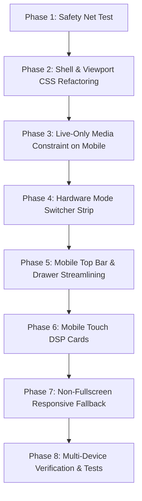

# SPECIFICATION: MOBILE VIEWPORT & SOUND CAMERA REDESIGN

**Document Version:** 1.0.0  
**Date:** 2026-10-10  
**Status:** Approved for Implementation  
**Classification:** Mobile UX / Touch Ergonomics / Analog Telemetry System  
**Parent Specification:** `docs/UI_DESIGN_PROTOCOL.md` & `SPECS.md`  

---

## 1. Executive Summary & Core Requirements

Sonification V2 is a dual-modality instrument:
1. **Desktop:** A high-precision Eurorack modular laboratory console for in-depth audio DSP patch architecture, offline video rendering, and multi-file databending.
2. **Mobile (Handheld):** A dedicated, tactile **Live Sound Camera & Optical Transducer Sensor** (inspired by Teenage Engineering OP-1/Field hardware and Sound Devices field recorders).

### Key Decisions & Invariants
* **Strict Desktop Isolation (Zero Regression):** Desktop layout, mouse-optimized rotary dials, CRT monitor bay, multi-column modular grid, and file loaders must remain 100% pixel-perfect and functionally unaffected.
* **Live-Only on Mobile:** The "Open Image" and "Open Video" file pickers are disabled/hidden on mobile devices. The handheld device is dedicated exclusively to the live optical camera sensor stream and real-time audio transduction.
* **Full-Height 100dvh Viewport:** Eliminate the current black void and floating shutter buttons. The camera viewfinder fills the screen cleanly with analog drafting framing and ergonomic thumb-anchored controls.
* **Clean Mode Separation:** Dedicated switching between **Optical Viewfinder (`CAM`)**, **CRT Oscilloscope & VU Telemetry (`SCOPE`)**, and **Touch DSP Controls (`RACK`)** to eliminate screen clutter and visual collisions.

---

## 2. Baseline Defect Audit & Root-Cause Matrix

| Defect Area | Current Symptom (from User Screenshots) | Root Cause in Code | Target Resolution |
| :--- | :--- | :--- | :--- |
| **Viewport Sizing** | Upper 40% image frame, large black void below; buttons float awkwardly in the center. | `.canvas-frame` has `max-height: calc(100vh - 220px)` from `telemetry.css`; `#mobile-camera-hud` is nested inside `.canvas-frame` instead of viewport. | Lift `#mobile-camera-hud` to fixed viewport root with `100dvh`; expand canvas to fit viewport with analog matte framing. |
| **Top Navigation** | Hamburger `[=]`, preset pill, `HUD OFF`, and `CAM: LIVE` badges cram and overlap on narrow screens. | 4 bulky flex items forced into a single 375px row without flex-shrink or responsive breakpoints. | Streamline top bar: Hamburger `[=]`, centered truncated preset pill `[● Name ▾]`, and live status badge `[● LIVE]`. |
| **HUD / Scope Collision** | Shutter and REC buttons float directly over the CRT oscilloscope graph when HUD is ON. | `#telemetry-hud-bay` and `.canvas-frame` are toggled in parallel under the same HUD overlay. | Establish dedicated mode switcher (`CAM` vs. `SCOPE` vs. `RACK`). Camera shutter only appears in `CAM` mode. |
| **DSP Module Rack** | 5 micro-knobs per row with truncated labels (`FLUTT...`, `RELEA...`) and cramped action buttons. | Desktop rack (`.sidebar-rack-panel`) is dumped directly into mobile overlay without touch adaptation. | Adapt DSP parameters on mobile to 2-column touch cards with horizontal touch faders and large numerical badges. |
| **Non-Fullscreen Desktop Fallback** | Text collision between footer, hero bar, and rack (`SONIFICATIONBIT FLOATING V2...`). | `.sidebar-rack-panel` hardcoded to `width: 460px` in `layout.css`; footer lacks mobile flex wrapping. | Add mobile responsive media queries (`max-width: 900px`) to wrap footer cleanly and set rack width to `100%`. |
| **Media Selection** | Image/Video file pickers shown in mobile drawer/rack, cluttering UI. | Desktop file inputs rendered indiscriminately across all screen sizes. | Hide image/video file inputs on mobile screens (`max-width: 900px`), locking mobile to live camera sensor. |

---

## 3. Architecture & Functional Specification

### 3.1 Mobile Viewport Layout (`100dvh`)
```
+--------------------------------------------------------+
| [=]           * Acid 303 Decay v           [* LIVE]    |  <-- Top Hardware Bar
+--------------------------------------------------------+
|                                                        |
|                                                        |
|                 OPTICAL SENSOR VIEWPORT                |
|               (or CRT OSCILLOSCOPE in SCOPE)           |
|                                                        |
|             |--+                                +--|   |
|             |           RETICLE HUD             |   |
|             |--+                                +--|   |
|                                                        |
+--------------------------------------------------------+
|        [ CAM ]          [ SCOPE ]         [ RACK ]     |  <-- Hardware Mode Switcher
+--------------------------------------------------------+
|   [FLIP]         ((  SHUTTER  ))         [REC]  [MUTE] |  <-- Thumb Control Bar (CAM)
|   (or Telemetry Meters in SCOPE / FX Controls in RACK) |
+--------------------------------------------------------+
```

### 3.2 The Three Hardware Modes

#### Mode 1: Optical Viewfinder (`CAM` - Default)
* **Visuals:** Edge-to-edge optical video feed framed with 1px drafting ticks (`┌ ┐ └ ┘`).
* **Overlay:** Optional reticle HUD displaying crosshair, sample seed, and focus frame.
* **Bottom Controls:** 
  * `FLIP` button (switches rear/front camera with smooth transition).
  * Large central Shutter button (captures high-res databent still photo with analog white flash).
  * Hardware REC button with blinking tally LED (records video + audio loop).
  * Master Audio Mute toggle with instant visual LED feedback (`MUTED` / `LIVE`).

#### Mode 2: Cathode Oscilloscope (`SCOPE`)
* **Visuals:** Dedicated CRT waveform bay (`#hud-canvas`) with green phosphor electron beam and graticule grid.
* **Telemetry Matrix:** Monospace readouts for `SAMPLE BUS` (44.1 kHz), `PEAK LEVEL` (dB), `SIGNAL RMS`, and `SCAN SEED`.
* **Meters:** Discrete segmented LED ladder VU meters (`VU L` / `VU R`) with smooth real-time animation.
* **No Camera Buttons:** Shutter and camera buttons are hidden in `SCOPE` mode, giving full unobstructed visibility to the CRT display.

#### Mode 3: Touch DSP Chain (`RACK`)
* **Visuals:** Clean, touch-optimized slide-over bottom sheet or rack view.
* **Topology:** Fast dropdowns for Color Space (RGB, LAB, HSL) and Scan Mode (Planar, Hilbert, Hilbert Diagonal).
* **DSP Modules:** Active filter modules rendered as **2-column touch cards**:
  * Module title & bypass switch (`[ON] / [BYP]`).
  * Horizontal touch faders with parameter names and calibrated numeric values.
  * Easy module reordering or adding via `[+ ADD EFFECT]`.

---

## 4. Desktop Safety & Invariant Guarantees

To ensure that desktop performance and visual design are never impacted:

1. **Scoped CSS Media Queries:**
   * All mobile layout rules must be scoped strictly under `@media (max-width: 900px)` or `.is-fullscreen` when initiated by mobile devices.
   * Desktop layout rules in `layout.css`, `rack.css`, and `viewport.css` for viewports > 900px remain untouched.
2. **File Loader Availability:**
   * `#input-file` and `#input-video-file` remain fully functional and visible on desktop.
   * On mobile (`@media (max-width: 900px)`), these inputs are hidden via CSS (`display: none !important`), presenting only the Live Camera interface.
3. **Automated Safety Net:**
   * `tests/desktop_safety_net.test.mjs` verifies all desktop DOM landmarks, inputs, tools, and layout definitions on every build.
   * Existing `tests/regression.test.mjs` ensures zero regressions in audio processing, camera stream lifecycle, and filter math.

---

## 5. Implementation Phases



### Phase 1: Safety Net Test (Completed)
* File: `tests/desktop_safety_net.test.mjs`
* Verifies desktop structural landmarks, input elements, transport controls, and token integrity.

### Phase 2: Shell & Viewport CSS Refactoring
* File: `src/styles/mobile.css` & `src/styles/viewport.css`
* Set body and app height to `100dvh` in mobile mode.
* Detach `#mobile-camera-hud` from `.canvas-frame` into fixed viewport overlay.
* Anchor `.mobile-bottom-bar` to `env(safe-area-inset-bottom)`.
* Reset `max-height` constraints on mobile so the canvas fills the viewport without dead black space.

### Phase 3: Mobile Media Constraint (Live Camera Only)
* File: `src/styles/mobile.css` & `src/ui/mobile-controller.ts`
* Hide "Open image" and "Open video" file labels on mobile devices (`max-width: 900px`).
* Ensure mobile entry directly engages the camera sensor without confusing upload prompts.

### Phase 4: Hardware Mode Switcher Strip
* File: `index.html`, `src/styles/mobile.css`, `src/ui/mobile-controller.ts`
* Add compact 3-way segmented button: `[ CAM ]` | `[ SCOPE ]` | `[ RACK ]`.
* Toggling updates active view:
  * `CAM`: Viewfinder + thumb shutter bar.
  * `SCOPE`: CRT Oscilloscope + telemetry matrix + VU meters.
  * `RACK`: Touch-friendly DSP parameter drawer/sheet.

### Phase 5: Mobile Top Bar & Drawer Streamlining
* File: `index.html`, `src/styles/mobile.css`
* Clean up `.mobile-top-bar` items:
  * Left: `[=]` hamburger drawer button.
  * Center: `.mobile-preset-pill` with `text-overflow: ellipsis` and `max-width: 50%`.
  * Right: `[● LIVE]` status badge + optional settings trigger.
* Prevent any element collision down to 360px screen width.

### Phase 6: Mobile Touch DSP Cards
* File: `src/styles/mobile.css` & `src/ui/rack-controller.ts`
* Add responsive 2-column styles for parameter knobs/sliders when viewed on mobile screens.
* Ensure all interactive touch targets meet the minimum 44×44pt touch area.

### Phase 7: Non-Fullscreen Responsive Fallback
* File: `src/styles/layout.css` & `src/styles/mobile.css`
* Ensure `.sidebar-rack-panel` is `width: 100%` on mobile.
* Prevent text collisions in the studio footer and hero bar by adding proper flex wrapping and padding.

### Phase 8: Multi-Device Verification
* Run automated test suites: `npm test`.
* Validate TypeScript build: `npm run build`.
* Test on device viewports:
  * iPhone SE (375 × 667)
  * iPhone 14/15/16 Pro (393 × 852)
  * Android / Pixel (412 × 915)
  * Desktop (1440 × 900, 1920 × 1080)

---

## 6. Acceptance Criteria

1. **Desktop View:**
   * Desktop layout remains 100% unchanged: 460px left rack, right fitted viewport, side CRT monitor bay, top ribbon, hero metadata strip, and footer.
   * Image and video file uploads remain fully functional on desktop.
   * `npm test` passes all tests with zero errors.
2. **Mobile View:**
   * Canvas fills the viewport cleanly without vertical dead black space.
   * Thumb action bar (Shutter, REC, Flip, Mute) sits comfortably at the bottom above the home bar.
   * Top bar never wraps or clips elements on 375px+ screens.
   * "Open image" and "Open video" are absent on mobile; live camera feed is primary.
   * Switching between `CAM`, `SCOPE`, and `RACK` is instant, smooth, and unobstructed.
   * DSP parameters are readable without truncated labels.
